

<!--
  OBSERVATION DECK design - an alternative to README.md, kept side by side.
  To go live: copy this file over README.md (the image paths work unchanged).
  Static art:  python scripts/deck_assets.py   (copy in scripts/deck_content.py)
  Live cards:  built every 12h by .github/workflows/main.yml -> `telemetry` branch
-->

<!-- ═══════════════════════════ HERO ═══════════════════════════ -->

<a href="https://nimna-niwarthana.com"></a>

<a href="https://nimna-niwarthana.com"></a><a href="https://www.linkedin.com/in/nimna-niwarthana"></a><a href="https://twitter.com/niwarthananimna"></a><a href="https://www.buymeacoffee.com/nimna"></a>

<!-- ═══════════════════════════ LIVE STATS ═══════════════════════════ -->


<!-- ═══════════════════════════ CREW PROFILE ═══════════════════════════ -->

<a href="https://nimna-niwarthana.com/#/about"></a>

<!-- ═══════════════════════════ TECH ARSENAL ═══════════════════════════ -->

<picture>
  <source media="(prefers-color-scheme: dark)" srcset="assets/deck/h-arsenal-dark.svg" />
  <source media="(prefers-color-scheme: light)" srcset="assets/deck/h-arsenal-light.svg" />
  
</picture>

<!-- ═══════════════════════════ FEATURED WORK ═══════════════════════════ -->

<picture>
  <source media="(prefers-color-scheme: dark)" srcset="assets/deck/h-work-dark.svg" />
  <source media="(prefers-color-scheme: light)" srcset="assets/deck/h-work-light.svg" />
  
</picture>

<a href="https://catalogie.com/"></a><a href="https://github.com/nimna29/malditectist-webapp-heroku"></a><a href="https://github.com/nimna29/malscraper"></a><a href="https://nimna-niwarthana.com/#/projects"></a>

<!-- ═══════════════════════════ FLIGHT ACTIVITY ═══════════════════════════ -->
<!-- Generated every 12h by .github/workflows/main.yml -> published to the `telemetry` branch -->

<picture>
  <source media="(prefers-color-scheme: dark)" srcset="assets/deck/h-activity-dark.svg" />
  <source media="(prefers-color-scheme: light)" srcset="assets/deck/h-activity-light.svg" />
  
</picture>


<!-- ═══════════════════════════ FOOTER ═══════════════════════════ -->

<a href="https://nimna-niwarthana.com"></a>

