

<!-- ═══════════════════════════ HERO ═══════════════════════════ -->
<a href="https://nimna-niwarthana.com"></a>

<a href="https://www.buymeacoffee.com/nimna"></a>

  

<!-- ═══════════════════════════ 01 · ABOUT ═══════════════════════════ -->

<a href="https://nimna-niwarthana.com/#/about"></a>

⚡ <i>Fun fact: dark mode isn't just easier on the eyes — it keeps the bugs away, because bugs are attracted to light.</i>

  

<!-- ═══════════════════════════ 02 · STACK ═══════════════════════════ -->


  

<!-- ═══════════════════════════ 03 · PROJECTS ═══════════════════════════ -->

<a href="https://catalogie.com/"></a>
<a href="https://github.com/nimna29/malditectist-webapp-heroku"></a>
<a href="https://github.com/nimna29/malscraper"></a>
<a href="https://nimna-niwarthana.com/#/projects"></a>

  

<!-- ═══════════════════════════ 04 · STATS ═══════════════════════════ -->
<!-- Generated every 12h by .github/workflows/main.yml → published to the `output` branch -->

  

<!-- ═══════════════════════════ 05 · SNAKE ═══════════════════════════ -->

<picture>
  <source media="(prefers-color-scheme: dark)" srcset="https://raw.githubusercontent.com/nimna29/Nimna29/output/github-contribution-grid-snake-dark.svg" />
  <source media="(prefers-color-scheme: light)" srcset="https://raw.githubusercontent.com/nimna29/Nimna29/output/github-contribution-grid-snake.svg" />
  
</picture>

  

<!-- ═══════════════════════════ FOOTER ═══════════════════════════ -->
<a href="https://nimna-niwarthana.com"></a>

